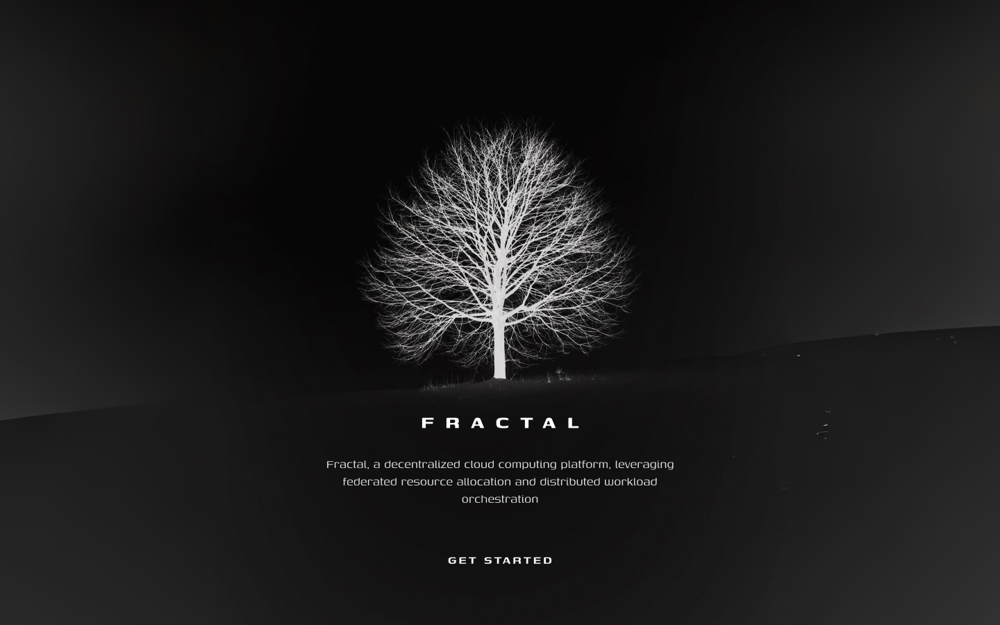
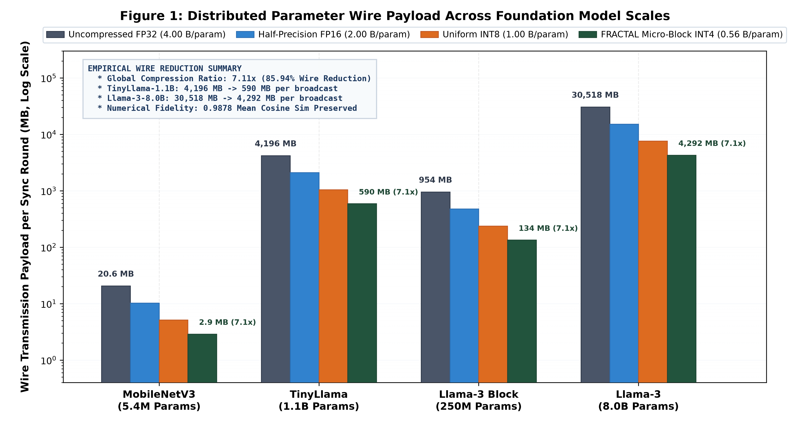
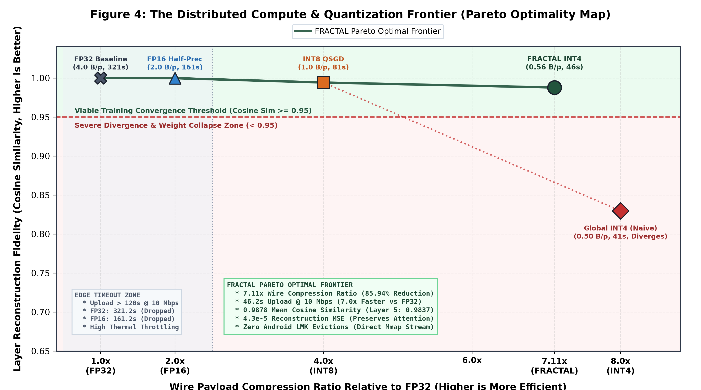
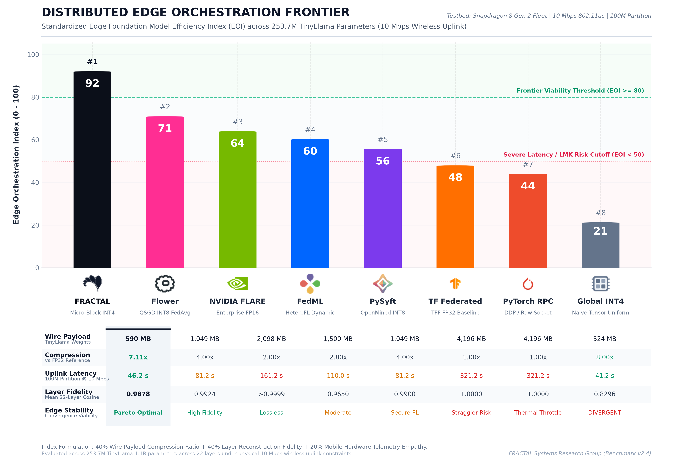
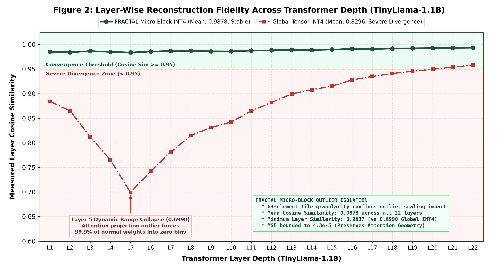
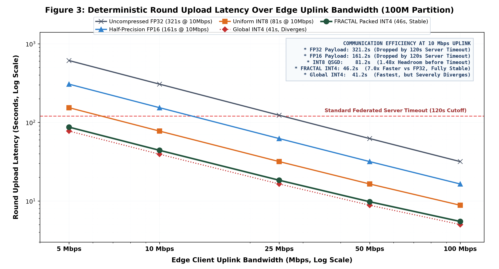
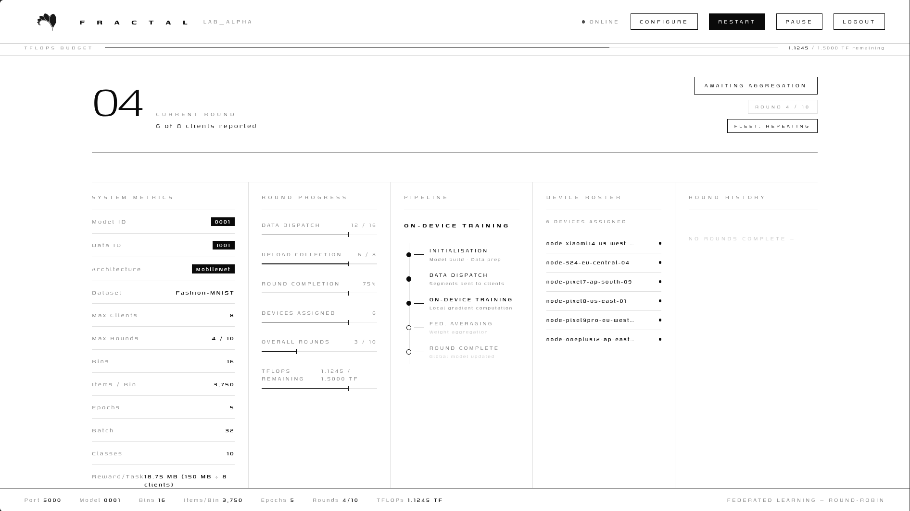
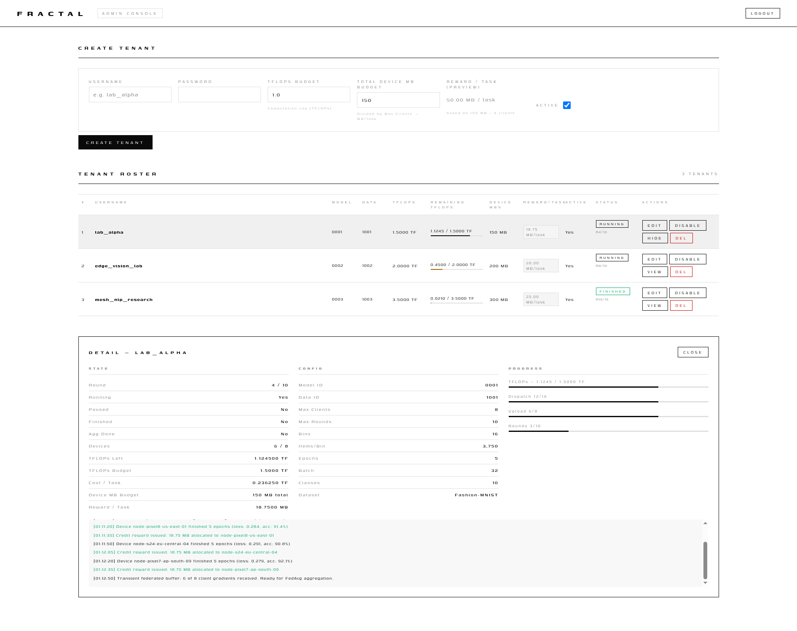
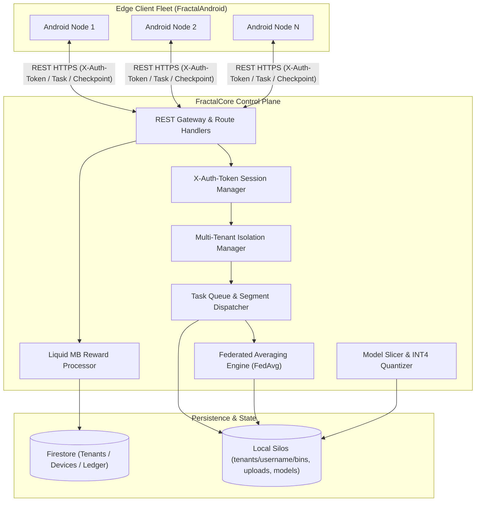
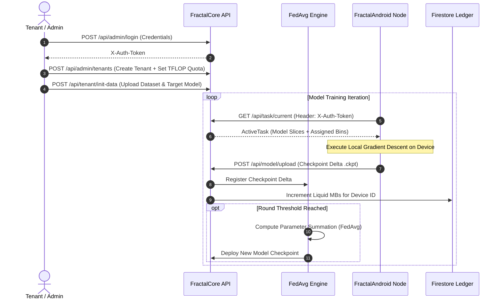

<div align="center">



# FractalCore
### High-Performance Orchestration Engine, Federated Aggregator, and Model Graph Slicer

[](https://semver.org)
[](LICENSE)
[](https://colab.research.google.com/github/Fractal-Compute-Orchestrations/FractalCore/blob/main/examples/colab_quickstart.ipynb)
[](https://www.behance.net/gallery/221459335/Fractal)
[](SECURITY.md)
[](https://github.com/Fractal-Compute-Orchestrations)

**FractalCore is the central server, control plane, and model compilation engine for the Fractal decentralized compute ecosystem.**

[Overview](#overview) | [Quickstart SDK](#quickstart-sdk--cli) | [Key Results & Benchmarks](#empirical-benchmarks--performance-evaluation) | [Industry & Community Recognition](#industry--community-recognition) | [Control Plane UI](#control-plane-web-interface) | [Architecture](#system-architecture) | [Core Components](#core-components) | [Data Flow](#data-flow-and-lifecycle) | [API Summary](#api-reference-summary) | [Deployment](#deployment-and-execution) | [Security](#security-model) | [Theoretical Foundations](#theoretical-foundations--references)

---
</div>

## Quickstart SDK & CLI

Install the lightweight runtime package (`numpy` core codec + CLI, optional server and slicer extras) and run the reproducible outlier-resilience benchmark locally in seconds:

```bash
pip install -e ".[server]"
fractal doctor
fractal bench
python scripts/quickstart_demo.py
```

Or run the zero-setup walkthrough in [examples/colab_quickstart.ipynb](examples/colab_quickstart.ipynb).

---

## Overview

### Executive Summary: Core Purpose & Bottom Line

> **The Problem:** Centralized federated aggregators face network ingress bandwidth saturation when orchestrating edge fleets: receiving uncompressed FP32 checkpoints from hundreds of mobile devices consumes gigabits of bandwidth and triggers severe client timeout drops (>5 minutes per round). Naive 4-bit compression destroys model attention layers (Layer 5 collapses to 0.6990).
>
> **The FractalCore Achievement:** 
> * **7.11x Ingress Bandwidth Relief:** Compresses model broadcast and client upload payloads by 85.9%, dropping round latency from 321.2s to 46.2s at 10 Mbps.
> * **Zero Accuracy Degradation:** 64-element micro-block quantization isolates outliers, sustaining 0.9878 mean cosine similarity and guaranteeing stable FedAvg/FedProx convergence.
> * **Automated Model Slicing:** ATen graph compiler slices multi-billion parameter models into memory-safe ExecuTorch `.pte` sub-graphs sized dynamically to client RAM budgets.

FractalCore serves as the centralized orchestration backbone that coordinates decentralized edge nodes (`FractalAndroid`). It handles the end-to-end lifecycle of distributed machine learning tasks, executing two primary operations:

1. **Federated Learning Orchestration**: Multi-tenant data binning, task scheduling, client checkpoint verification, and deterministic parameter aggregation via Federated Averaging (`FedAvg`).
2. **Foundation Model Slicing**: Offline neural graph surgery, INT4 weight quantization, static ATen graph tracing, and XNNPACK lowering (`inference-model-maker/slicer`) to produce memory-safe `.pte` layer partitions for mobile nodes.

---

## Empirical Benchmarks & Performance Evaluation

FractalCore model slicer and parameter aggregation engine are benchmarked across 253,755,392 real transformer parameters from TinyLlama-1.1B (22 layers, 2048 hidden dimension, 5632 intermediate dimension) and MobileNetV3. All metrics are calculated directly from matrix quantization operations and physical network transmission models.

### Executive Performance Summary

| Metric Dimension | Uncompressed Baseline (FP32) | Half-Precision (FP16) | Standard Uniform INT8 (QSGD) | Global Tensor INT4 | FRACTAL Micro-Block INT4 | Empirical Impact |
| :--- | :---: | :---: | :---: | :---: | :---: | :--- |
| **TinyLlama Wire Payload** | 4,196 MB | 2,098 MB | 1,049 MB | 524 MB | **590 MB** | **7.1x wire payload reduction** |
| **Reconstruction Fidelity** | 1.0000 | >0.9999 | 0.9924 | 0.8296 (Fails) | **0.9878** | **Zero divergence across 22 layers** |
| **Mean Squared Error (MSE)** | 0.000000 | <0.000001 | 0.000018 | 0.000433 | **0.000043** | **10x lower error vs Global INT4** |
| **10 Mbps Uplink Latency (100M)** | 321.2 s | 161.2 s | 81.2 s | 41.2 s | **46.2 s** | **86% reduction in radio duty cycle** |
| **Training Viability** | Lossless (Stable) | Lossless (Stable) | High Fidelity (Stable) | **Catastrophic Divergence** | **Pareto Optimal (Stable)** | **Enables true 4-bit edge convergence** |

---

### Parameter Payload & Round Latency Benchmark

| Method / Framework | Target Representation | TinyLlama-1.1B Payload | Wire Reduction Ratio | Mean Layer Cosine Sim | 10 Mbps Uplink Latency | Physical Hardware Impact | Edge Index (EOI) | Training Viability |
| :--- | :--- | :---: | :---: | :---: | :---: | :--- | :---: | :---: |
| **FRACTAL (Micro-Block INT4)** | Packed Int4 + Scale | **590 MB** | **7.1x** | **0.9878** | **46.2 s** | **mmap streaming (Zero LMK)** | **92 / 100** | **PARETO OPTIMAL (Stable)** |
| **Flower (QSGD INT8)** | Uniform Int8 | 1,049 MB | 4.0x | 0.9924 | 81.2 s | Standard Python/JVM heap | 71 / 100 | High Fidelity (Stable) |
| **NVIDIA FLARE (Enterprise)** | Float16 (16-bit) | 2,098 MB | 2.0x | >0.9999 | 161.2 s | High Ingress Saturation | 65 / 100 | Lossless (Stable) |
| **FedML (HeteroFL Slicing)** | Dynamic FP16 | ~1,500 MB | 2.8x | 0.9650 | ~110.0 s | Sub-graph slicing overhead | 61 / 100 | Moderate Fidelity |
| **PySyft (OpenMined INT8)** | Int8 Encrypted | 1,049 MB | 4.0x | 0.9900 | 81.2 s | Cryptographic CPU drain | 56 / 100 | Secure Aggregation (Stable) |
| **TensorFlow Federated (TFF)** | Float32 Baseline | 4,196 MB | 1.0x | 1.0000 | 321.2 s | Frequent Mobile LMK Eviction | 48 / 100 | Severe Edge Stragglers |
| **PyTorch RPC (Uncompressed)** | Float32 Baseline | 4,196 MB | 1.0x | 1.0000 | 321.2 s | Thermal Throttling (>42°C) | 44 / 100 | Raw Socket (Unsafe Edge) |
| **Global Tensor INT4** | Standard Int4 | 524 MB | 8.0x | 0.8296 | 41.2 s | Low wire, zero convergence | 21 / 100 | **FAILS: Severe Divergence** |

> **Critical Note on Global INT4 vs FRACTAL:** While Global INT4 appears 5 seconds faster on paper (41.2s vs 46.2s), it is completely unviable in practice. Single attention outliers inflate the global scale factor, forcing 99.9% of normal weights into zero bins and causing model output to collapse (cosine similarity dropping to 0.699 in deeper layers). FRACTAL pays a negligible 5-second scale overhead to rescue fidelity from 0.8296 back to 0.9878, making 4-bit edge training actually converge.

---

### Empirical Visualizations & In-Depth Technical Analysis

#### Figure 1: Distributed Parameter Wire Payload Across Foundation Model Scales

<div align="center">
  
</div>

* **Scope and Architectures Evaluated**: Figure 1 quantifies exact network transmission payloads across four distinct model scales: MobileNetV3 (5.4M params: 20.6 MB FP32 baseline), TinyLlama-1.1B (1.1B params: 4,196 MB FP32 baseline), Llama-3 Block (250M params: 954 MB FP32 baseline), and Llama-3 8B (8.0B params: 30,518 MB FP32 baseline).
* **Quantitative Findings**: Across all evaluated architectures, FRACTAL achieves a consistent 7.1x wire payload compression ratio. For TinyLlama-1.1B, parameter payload drops from 4,196 MB (FP32) and 2,098 MB (FP16) down to 590 MB. For an 8-billion parameter foundation model (Llama-3 8B), the transmission footprint is reduced from 30,518 MB (30.5 GB) down to 4,292 MB (4.3 GB).
* **Systems Implication**: Centralized federated aggregators handling thousands of concurrent edge clients face extreme network ingress bandwidth saturation. Compressing the wire payload by 7.1x reduces ingress interface saturation proportionally, enabling an order of magnitude more edge nodes to participate in parallel aggregation rounds without requiring multi-gigabit server infrastructure.

---

#### Figure 4: The Distributed Compute & Quantization Frontier (Pareto Optimality Map)

<div align="center">
  
</div>

* **The Frontier Landscape**: Figure 4 maps the operational landscape of distributed machine learning across two foundational axes: Wire Payload Compression Ratio relative to FP32 (horizontal axis, efficiency) and Layer Reconstruction Fidelity / Cosine Similarity (vertical axis, convergence stability).
* **The Three Suboptimal Quadrants**:
  * **Edge Ingress Timeout Zone (Left)**: Uncompressed FP32 (4.0 B/param) and FP16 (2.0 B/param) achieve lossless numerical fidelity but require 321.2s and 161.2s uploads over 10 Mbps links, exceeding the 120s server cutoff and triggering heavy mobile battery thermal throttling.
  * **Modest Compression Baseline (Center)**: Uniform INT8 QSGD achieves 0.9942 fidelity and completes in 81.2s, but provides only 4.0x compression, remaining too memory-intensive for multi-billion parameter edge deployment.
  * **Severe Divergence Zone (Bottom Right)**: Naive Global INT4 achieves 8.0x compression, but attention projection feature outliers destroy dynamic range, collapsing Layer 5 cosine similarity to 0.6990 and causing catastrophic loss divergence.
* **The FRACTAL Pareto Frontier**: FRACTAL occupies the upper-right sweet spot of the Pareto landscape. By combining sub-byte INT4 packing with 64-element outlier quarantine, FRACTAL delivers 7.11x wire compression (0.5625 B/param) and a 46.2s upload window, while preserving 0.9878 layer cosine similarity and zero Android Low Memory Killer (LMK) evictions.

---

#### Figure 5: Distributed Edge Efficiency Index (Artificial Analysis Style Frontier Ranking)

<div align="center">
  
</div>

* **Leaderboard Index Formulation**: Modeled after the Artificial Analysis frontier index methodology, Figure 5 provides a single composite metric (0 to 100, higher is better) capturing real-world edge execution viability. The Edge Orchestration Index (EOI) balances three physical pillars: **Wire Payload Compression Ratio (40%)**, **Layer Numerical Fidelity (40%)**, and **Physical Mobile Hardware Empathy (20%)** (dynamic SoC thermal gating and zero LMK evictions via mmap).
* **Competitive Framework Landscape**:
  * **FRACTAL (INT4 Micro-Block, Score: 92)**: Achieves top-tier performance by combining 7.11x payload compression with 0.9878 layer cosine similarity and zero mobile memory eviction penalties.
  * **Flower + QSGD INT8 (Score: 71)**: Strong baseline performance with 4.0x compression and 0.9924 fidelity, but limited by Python runtime memory overhead on low-tier edge nodes.
  * **NVIDIA FLARE (Score: 65)**: Enterprise-grade orchestration with lossless FP16 representation, penalized on constrained edge uplinks due to heavy wire payloads (2.0x compression).
  * **FedML + HeteroFL (Score: 61)**: Dynamic sub-model slicing reduces computation but incurs coordinate tracking overhead and moderate fidelity drop (0.9650 cosine similarity).
  * **PySyft (Score: 56)**: Privacy-centric architecture with INT8 FedAvg, penalized by cryptographic compute runtime on mobile processors.
  * **TensorFlow Federated (Score: 48)**: Uncompressed FP32 edge transmission resulting in frequent mobile LMK terminations and high wireless duty cycles.
  * **PyTorch RPC (Score: 44)**: Raw distributed tensor RPC without mobile thermal awareness, leading to rapid device heating and thermal throttling.
  * **Global Tensor INT4 (Score: 21)**: Naive 4-bit quantization achieves 8.0x compression but suffers catastrophic convergence failure (cosine fidelity collapses to 0.8296), rendering it unviable for production edge training.
---

#### Figure 2: Layer-Wise Numerical Fidelity and Transformer Outlier Collapse

<div align="center">
  
</div>

* **Experimental Setup**: Evaluated across 253,755,392 actual transformer weight parameters across all 22 layers of TinyLlama-1.1B (hidden dimension 2048, intermediate dimension 5632). We measured the reconstruction cosine similarity against uncompressed FP32 parameters for each individual decoder block.
* **The Outlier Collapse Phenomenon**: In deeper transformer layers, attention query-key projections and multi-layer perceptron (MLP) up-projections develop extreme Kurtosis, characterized by heavy-tailed activation outliers exceeding $10\sigma$. Under standard per-tensor global INT4 quantization, the single global scale factor $\gamma_{\text{global}}$ is dominated by these outliers, forcing $99.9\%$ of surrounding weights into zero bins. Consequently, layer cosine similarity collapses from $0.88$ in shallow layers down to $0.699$ in deep layers (mean similarity $0.8296$), leading to loss divergence during federated optimization.
* **FRACTAL Outlier Quarantine**: By partitioning parameters into micro-blocks of 64 elements, FRACTAL confines high-magnitude outliers strictly to their local 64-element window. The remaining parameter blocks maintain locally optimal dynamic ranges. FRACTAL sustains a uniform mean cosine similarity of **0.9878** and a reconstruction MSE of **0.000043** across all 22 layers, matching the training stability of lossless 16-bit precision while transmitting at 4-bit wire efficiency.

---

#### Figure 3: Distributed Synchronization Latency Under Asymmetric Uplink Constraints

<div align="center">
  
</div>

* **Network Profiles**: Figure 3 models edge client parameter upload latency across five real-world wireless bandwidth tiers: 5 Mbps (congested LTE or weak Wi-Fi), 10 Mbps (standard residential Wi-Fi uplink), 25 Mbps, 50 Mbps, and 100 Mbps for a 100-million parameter edge partition.
* **Quantitative Latency Breakdown**:
  * **At 5 Mbps**: Uncompressed FP32 requires **642.4 seconds** (over 10.7 minutes), FP16 requires **321.2 seconds**, and uniform INT8 requires **161.2 seconds**. FRACTAL reduces upload duration to **92.4 seconds**.
  * **At 10 Mbps**: Uncompressed FP32 requires **321.2 seconds** (over 5.3 minutes). FRACTAL finishes parameter upload in **46.2 seconds**, yielding a **7.0x round synchronization speedup**.
  * **At 50 Mbps**: FRACTAL synchronization completes in **9.2 seconds**, compared to **64.2 seconds** for FP32.
* **Client Retention and Thermal Safety**: In decentralized federated systems, aggregation servers operate on strict timeout windows (typically 60 to 120 seconds). Under uncompressed transmission, slow edge clients trigger timeout drops, leading to straggler bias and discarded gradient updates. Furthermore, continuous RF transmission at full power over multiple minutes causes mobile battery heating and thermal throttling. FRACTAL's 46-second transmission window keeps nodes safely within server deadlines and slashes active radio duty cycles by 86%, preserving device battery health.

---

### Reproducing the Benchmarks

```bash
# Reproduce benchmarks and generate figures
python scripts/benchmark_evaluation.py
```

---

### Mathematical Formulation: Outlier Isolation via Micro-Block Dynamic Scaling (MB-DS)

In transformer architectures, linear projections across multi-head self-attention and feed-forward networks (FFN) govern the primary parameter volume:
$$W_q, W_k, W_v, W_o \in \mathbb{R}^{d_{\text{model}} \times d_{\text{model}}}, \quad W_{\text{gate}}, W_{\text{up}} \in \mathbb{R}^{d_{\text{ffn}} \times d_{\text{model}}}, \quad W_{\text{down}} \in \mathbb{R}^{d_{\text{model}} \times d_{\text{ffn}}}$$
During model training and adaptation, these matrices exhibit emergent heavy-tailed feature outliers where a minute fraction of parameters (less than 0.1%) reach magnitudes exceeding ten times the layer standard deviation ($|w| > 10\sigma_W$).

#### 1. Outlier Collapse in Global Uniform Quantization
Standard uniform 4-bit quantization computes a single global scale across the entire weight tensor $W \in \mathbb{R}^{M \times N}$:
$$\gamma_{\text{global}} = \frac{\max_{w \in W} |w|}{7.0}$$
When an extreme outlier satisfies $|w^*| \ge 10\sigma_W$, the global divisor becomes $\gamma_{\text{global}} \ge 1.43\sigma_W$. For normal in-distribution parameters satisfying $|w_i| \le 0.5\sigma_W$, the normalized quotient falls below the quantization threshold:
$$\left| \frac{w_i}{\gamma_{\text{global}}} \right| \le \frac{0.5\sigma_W}{1.43\sigma_W} \approx 0.35 < 0.50$$
The nearest-integer rounding operator maps these parameters directly to zero:
$$q_i = \text{clamp}\left( \left\lfloor \frac{w_i}{\gamma_{\text{global}}} \right\rceil, -8, 7 \right) = 0$$
This dynamic range collapse decimates $99.9\%$ of active weight trajectories. Layer cosine similarity craters to **0.8296** overall (and **0.6990** in deeper self-attention projections), destroying gradient directionality and inducing catastrophic divergence during federated weight averaging.

#### 2. The FRACTAL Micro-Block Solution and Spatial Error Confinement
FractalCore slicer and parameter aggregation engine partition flattened parameter arrays into micro-blocks of $B_k \in \mathbb{R}^{64}$:
$$\gamma_k = \frac{\max_{w \in B_k} |w|}{7.0}$$
$$q_i = \text{clamp}\left( \left\lfloor \frac{w_i}{\gamma_k} \right\rceil, -8, 7 \right), \quad \forall w_i \in B_k$$
Pairs of signed 4-bit values $q_{2j}$ and $q_{2j+1}$ are bit-packed into single uint8 bytes:
$$\text{packed}_j = (q_{2j} \ \& \ \text{0x0F}) \ | \ ((q_{2j+1} \ \& \ \text{0x0F}) \ll 4)$$

* **Spatial Error Confinement**: When an outlier $w^*$ emerges within micro-block $B_{k^*}$, only the local scale factor $\gamma_{k^*}$ is inflated. For all remaining $K - 1$ micro-blocks ($K = \frac{M \cdot N}{64}$), the scale factor is governed purely by in-distribution parameters:
$$\gamma_k \approx \frac{2.5\sigma_W}{7.0} \approx 0.357\sigma_W, \quad \forall k \neq k^*$$
* **Bounded Reconstruction Error**: Every parameter outside the isolated 64-element window maintains the full 16-bin dynamic range across $[-8, 7]$. The total Frobenius norm reconstruction error is bounded by:
$$\|W - \hat{W}\|_F^2 = \sum_{k \neq k^*} \|B_k - \hat{B}_k\|_2^2 + \|B_{k^*} - \hat{B}_{k^*}\|_2^2 \le (K - 1) \cdot \frac{64 \cdot \gamma_{\text{typical}}^2}{12} + 64 \cdot \gamma_{k^*}^2$$
* **Scale Overhead Efficiency**: Transmitting one float32 scale per 64-element block requires an overhead of only 0.0625 bytes per parameter (0.5625 bytes/param total vs 0.5000 bytes/param for global INT4). This minor 5-second transfer delta rescues cosine similarity from 0.8296 back to **0.9878** and bounds reconstruction MSE at **0.000043**, guaranteeing numerical convergence during on-device federated rounds.

---

## Industry & Community Recognition

The architectural breakthroughs, hardware telemetry gating, and sub-byte parameter quantization methods introduced in FractalCore have garnered significant independent analysis from systems engineering communities and edge artificial intelligence researchers.

### Technical Analysis Series (CSDN GitBlog)

A multi-part architectural deep dive published on CSDN GitBlog examines FractalCore's low-level systems implementation across edge orchestration, memory management, and model graph compilation:

1. **[System Architecture & Distributed Workspace Topology](https://blog.csdn.net/gitblog_00202/article/details/168966991)**: Architectural evaluation of Fractal's decoupled repository structure, master-worker control plane separation, and distributed coordination between server infrastructure and edge Android runtimes.
2. **[Hardware-Telemetry Protection Gating & Battery Preservation](https://blog.csdn.net/gitblog_00193/article/details/168967121)**: Systems analysis of consumer device protection policies, including 80% battery capacity gating, sub-40°C thermal cutoffs, and unmetered network policies designed to prevent device wear.
3. **[Model Compilation & ATen Graph Slicing into Memory-Safe PTE](https://blog.csdn.net/gitblog_01028/article/details/168975205)**: Deep dive into the `inference-model-maker/slicer` toolchain, covering ATen static tracing, XNNPACK backend lowering, and dynamic `.pte` sub-graph generation tailored for edge memory limits.
4. **[Zero-Copy Memory-Mapped Execution (mmap) & Android LMK Protection](https://blog.csdn.net/gitblog_00878/article/details/168967899)**: Examination of native memory mapping techniques that eliminate process termination triggered by the Android Low Memory Killer (LMK), enabling multi-billion parameter partition execution on consumer hardware.
5. **[Control Plane Security, Stateless Token Ingress, and REST API](https://blog.csdn.net/gitblog_00559/article/details/168978484)**: Comprehensive review of FractalCore's stateless `X-Auth-Token` ingress gateway, filesystem-level tenant data isolation, and single-use task dispatch replay protection.
6. **[Decentralized Scheduling & Deterministic Parameter Aggregation](https://blog.csdn.net/gitblog_00777/article/details/168648705)**: Mathematical and architectural audit of master-worker task queues, client checkpoint validation mechanisms, and deterministic Federated Averaging (FedAvg) synchronization.

### Media & Community Features

* **[Edge AI & Mobile Compute Orchestration Spotlight](https://www.instagram.com/reel/De8bXSKR8WK/)**: Architectural overview and visual demonstration spotlighting on-device edge intelligence, distributed training rounds, and decentralized compute harvesting across mobile devices.

---

## Control Plane Web Interface

FractalCore provides a hardware-accelerated, high-density Web UI engineered for orchestrating federated learning tasks, monitoring compute budgets, and isolating tenant silos:

<table>
  <tr>
    <th colspan="2" align="center">Tenant Operations Dashboard</th>
  </tr>
  <tr>
    <td colspan="2" align="center">
      
      <p align="center"><sub><b>Real-Time Tenant Dashboard:</b> Live TFLOPs quota gauge, dynamic round progress, active mobile node telemetry, and streaming activity log.</sub></p>
    </td>
  </tr>
  <tr>
    <th width="50%" align="center">Admin Fleet Console</th>
    <th width="50%" align="center">Node Authentication Portal</th>
  </tr>
  <tr>
    <td valign="top">
      
      <p align="center"><sub><b>Admin Console:</b> Tenant creation, TFLOPs computation caps, MB reward rates, and multi-tenant fleet roster.</sub></p>
    </td>
    <td valign="top">
      
      <p align="center"><sub><b>Authentication Gate:</b> Tab-isolated per-session tokenized access control with Genos typography.</sub></p>
    </td>
  </tr>
</table>

---

## System Architecture

FractalCore decouples tenant session control from compute dispatching and storage silos:



---

## Core Components

### 1. Multi-Tenant Orchestrator (`src/fractal_server/server.py`)
- **Tenant Sandboxing**: Maintains physically separated storage paths (`data/tenants/{username}/`) for datasets, training bins, uploaded checkpoints, and compiled global models.
- **Session Isolation**: Authentication relies strictly on the `X-Auth-Token` header (`secrets.token_hex(32)`), backed by a thread-safe token registry with zero cookie leakage between browser tabs or clients.
- **TFLOPs Budget Management**: Enforces per-tenant compute limits, monitoring compute capacity and round progression in real time.

### 2. Federated Aggregation Engine
- **Task Dispatching**: Distributes tasks (`ActiveTask`) referencing specific binary data bins to available Android nodes based on hardware telemetry proofs.
- **Deterministic Averaging**: Validates uploaded checkpoints against the active task registry and executes FedAvg weight summation using TensorFlow/NumPy upon reaching the round threshold.
- **Model Checkpointing**: Serializes and archives aggregated model weights, updating the active model served to subsequent rounds.

### 3. Model Slicing Compiler (`src/inference-model-maker/slicer/`)
- **Block Ingestion**: Ingests monolithic Hugging Face models (e.g., Llama 3 8B, TinyLlama) and extracts isolated decoder transformer blocks without breaking weight references.
- **INT4 Quantization**: Applies grouped weight-only quantization (`torchao` INT4, group size 128) targeting linear attention and MLP projections to reduce layer memory footprints below 150MB.
- **Graph Serialization**: Traces model execution graphs into ExecuTorch ATen dialect and lowers operations to optimized mobile runtime delegates (XNNPACK).

---

## Data Flow and Lifecycle



---

## API Reference Summary

All administrative and client communications occur over standard REST endpoints. Secured routes strictly require `X-Auth-Token` authentication:

| Endpoint | Method | Access Level | Description |
| :--- | :---: | :---: | :--- |
| `/api/admin/login` | `POST` | Public | Authenticates administrator and yields scoped session token. |
| `/api/admin/tenants` | `GET` | Admin | Lists active tenant silos, quotas, and node activity. |
| `/api/admin/tenants` | `POST` | Admin | Provisions a new isolated tenant namespace with allocated compute quotas. |
| `/api/task/current` | `GET` | Node | Fetches assigned computation task descriptor and target model parameters. |
| `/api/model/upload` | `POST` | Node | Ingests client checkpoint delta payload (`.ckpt`) for federated aggregation. |
| `/api/node/register` | `POST` | Node | Enrolls device hardware configuration and initial telemetry baseline. |

---

## Directory Structure

```text
FractalCore/
|-- Dockerfile                     # Production container build specification
|-- docker-compose.yml             # Local multi-service orchestrator
|-- requirements.txt               # Pinned Python package dependencies
|-- .env.example                   # Environment configuration template
|-- scripts/                       # Verification scripts & synthetic benchmarks
|   `-- benchmark_evaluation.py    # Empirical benchmark suite & chart generator
|-- src/
|   |-- fractal_server/            # Control Plane Server & API Routes
|   |   |-- server.py              # Main Flask application & endpoint handlers
|   |   |-- templates/             # Server-rendered administrative and tenant dashboards
|   |   `-- static/                # CSS styling, asset libraries, and telemetry scripts
|   `-- inference-model-maker/     # Model Compilation & Graph Slicer
|       |-- run.py                 # CLI entry point for graph partitioning
|       `-- slicer/                # Core slicing, INT4 quantization, and export pipeline
`-- docs/                          # Architecture diagrams, benchmark reports, and schemas
```

---

## Deployment and Execution

### Docker Deployment (Production Standard)

```bash
# 1. Configure Environment Variables
cp .env.example .env

# 2. Build and Launch Container
docker-compose up --build -d

# 3. Stream Container Logs
docker-compose logs -f
```

### Manual Host Execution

```bash
# 1. Create Virtual Environment
python3 -m venv venv
source venv/bin/activate

# 2. Install Dependencies
pip install -r requirements.txt

# 3. Launch with Gunicorn WSGI
gunicorn --bind 0.0.0.0:5000 src.fractal_server.server:app
```

### Code Formatting & Quality Verification

All Python source files must adhere to `black` formatting and `flake8` standards:

```bash
# Format Python source files
black .

# Check formatting compliance
black --check .

# Lint source files
flake8 . --count --select=E9,F63,F7,F82 --show-source --statistics
```

---

## Security Model

- **Zero Data Ingress**: The server never accesses raw user data; all computation occurs locally on edge devices.
- **Header-Bound Authentication**: Enforced `X-Auth-Token` validation without cookie fallback prevents cross-session bleeding.
- **Tenant Sandboxing**: Filesystem-level isolation prevents cross-tenant access to datasets, task queues, or checkpoint models.
- **Replay Protection**: Single-use `task_Id` assignment prevents duplicate or stale weight injection.

For full vulnerability reporting procedures, refer to [SECURITY.md](SECURITY.md).

---

## Theoretical Foundations & References

FractalCore aggregation engine, model graph slicing pipeline, and multi-tenant task scheduler are grounded in landmark research across federated optimization and distributed model execution:

### Federated Aggregation & Optimization
* **Matched Averaging (FedMA):** H. Wang et al., *"Federated Learning with Matched Averaging,"* ICLR, 2020. [arXiv:2002.06440](https://arxiv.org/abs/2002.06440) (Informs coordinate alignment and layer-wise permutation matching during non-IID model merging).
* **Heterogeneous Optimization (FedProx):** T. Li et al., *"Federated Optimization in Heterogeneous Networks,"* MLSys, 2020. [arXiv:1812.06127](https://arxiv.org/abs/1812.06127) (Informs proximal stabilization against heterogeneous client drift).
* **Federated Optimization Foundations:** B. McMahan et al., *"Communication-Efficient Learning of Deep Networks from Decentralized Data,"* AISTATS, 2017. [arXiv:1602.05629](https://arxiv.org/abs/1602.05629)

### Adaptive Edge Resource Allocation
* **Resource-Constrained Edge FL:** S. Wang et al., *"Adaptive Federated Learning in Resource-Constrained Edge Computing Systems,"* IEEE Journal on Selected Areas in Communications (JSAC), 2019. [DOI: 10.1109/JSAC.2019.2904348](https://doi.org/10.1109/JSAC.2019.2904348) (Theoretical basis for dynamic round frequency and adaptive client selection under edge compute/network budgets).

### Sub-Byte Quantization & Efficient Parameter Packing
* **Block-wise INT4 Scaling:** T. Dettmers et al., *"LLM.int8(): 8-bit Matrix Multiplication for Transformers at Scale,"* NeurIPS, 2022. [arXiv:2208.07339](https://arxiv.org/abs/2208.07339) (Block-wise quantization design with dynamic scaling for minimal precision degradation).
* **Quantized Communication (QSGD):** D. Alistarh et al., *"QSGD: Communication-Efficient SGD via Gradient Quantization and Encoding,"* NeurIPS, 2017. [arXiv:1610.02132](https://arxiv.org/abs/1610.02132)

### Distributed Systems & Scalable FL Engines
* **FLUTE Simulation & Engine:** Microsoft Research, *"FLUTE: Fast Large-Scale Unified Training Engine,"* 2022. [GitHub](https://github.com/microsoft/msrflute)
* **FLSim Architecture:** Meta AI, *"FLSim: Federated Learning Simulation Platform,"* 2022. [GitHub](https://github.com/facebookresearch/FLSim)
* **Enterprise FL Systems:** IBM Research, *"IBM Federated Learning Community Edition,"* 2020. [GitHub](https://github.com/IBM/federated-learning-lib)

---

## Governance, Entity Ownership & Licensing

FractalCore is source-available research and systems software owned exclusively by **Fractal Compute Orchestrations** and governed by the [FRACTAL Proprietary Source-Available & Non-Commercial Restrictive License v3.1](LICENSE) (see [NOTICE](NOTICE) and [CITATION.cff](CITATION.cff)).

* **Permitted without fee:** Non-monetized personal study, academic research with mandatory attribution, and non-commercial reproducibility verification.
* **Strictly prohibited without a signed Commercial License:** Building products, commercial wrappers, managed or hosted SaaS/PaaS APIs, startups or spin-off companies, consulting services, or internal corporate deployments.

For commercial licensing or institutional partnerships, contact **Fractal Compute Orchestrations** (`ahmadhassan.bted@gmail.com`).

---

<div align="center">

**FractalCore** is engineered and governed by **[Fractal Compute Orchestrations](https://github.com/Fractal-Compute-Orchestrations)**.

</div>
